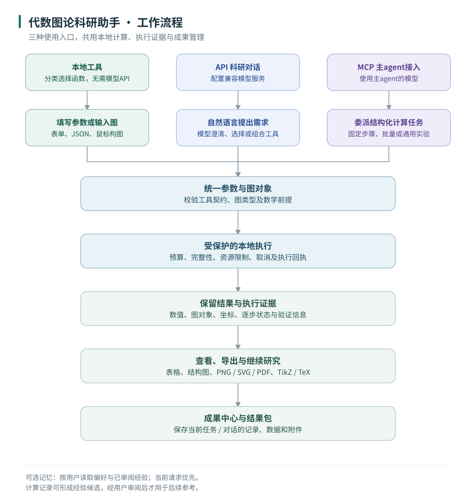

# 代数图论科研助手

**Algebraic Graph Theory Research Assistant** · 0.36.0rc6 · [MIT](LICENSE) · [English user guide](docs/QUICKSTART.md)

面向图与超图科研的 Python 计算工具和桌面应用，支持谱计算、符号运算、交互绘图与论文图形导出。既可独立使用，也可作为主 agent 的 MCP 计算服务。无需 SageMath 或 WSL。

## 能做什么

| 功能 | 当前支持 |
| --- | --- |
| 普通图 | 构图与结构变换、不变量、同构与对称性、商矩阵、数值谱、精确特征/匹配多项式、能量、带权及有向矩阵 |
| 超图 | 构造与变换、结构分析、一致超图 α 谱半径与 Perron 向量、赋权关联矩阵、张量方程与小规模精确消元 |
| 代数与组合 | 矩阵与分块运算、递推、整数线性方程、符号求和/级数、有限置换群、Cayley 图、车多项式 |
| 图形 | 鼠标构图、拖动布局和坐标保存、图片/TikZ 导出、含不确定长度超路的论文示意图 |
| 科研流程 | 批量任务、会话结果包、成果清理与恢复、用户偏好与经审阅经验、独立扩展工具库 |

桌面右上方的 **语言 / Language** 菜单可切换 **简体中文 / English**，选择自动保存。切换保留参数草稿和运行中的计算；原始数据、图标签与模型回复保持原文。

目前有 **43 个内置计算工具**；桌面将部分绘图工具整合到对应图旁。详细定义、条件与规模限制见[功能说明](docs/FEATURES.md)，参数和可导入例子见[工具输入手册](docs/OFFLINE_INPUTS.md)。

## 安装与启动

在[发布页](https://github.com/735336168liuxiaoqi-hub/algebraic-graph-theory-research-assistant/releases/tag/v0.36.0rc6)下载源码 ZIP，解压后在含 `pyproject.toml` 的目录打开 PowerShell。仓库私有时，需要获授权的 GitHub 账号。

完整桌面与受保护计算流程目前在 Windows 验证。使用 64 位 Python 3.11+，建议 3.13：

```powershell
python -m venv .venv
.\.venv\Scripts\python.exe -m pip install ".[all]"
.\.venv\Scripts\python.exe -m graph_research desktop
```

首次安装会下载依赖。以后可双击 `start-desktop.cmd` 或同目录的 `.exe` 启动器，需保留整个项目目录。使用已有 Conda/venv、wheel 安装或换电脑，请按[使用指南](使用指南.md)操作。

## 选择入口

| 方式 | 如何开始 | 模型配置 |
| --- | --- | --- |
| 本地工具 | 桌面选择“本地工具”，选函数、填参数、计算 | 无需 API |
| API 科研对话 | 桌面选择“科研对话”，配置模型后自然语言提问 | 配置兼容模型服务 |
| MCP 子 agent | 生成 MCP 配置，交给支持 STDIO 的主 agent 启动 | 固定工具任务无需本助手另配 API |



## 文档怎么读

**第一次使用读前两项即可。**

| 文档 | 内容 |
| --- | --- |
| [使用指南](使用指南.md) | 安装、三种模式、首个算例、结果保存与常见问题 |
| [功能说明](docs/FEATURES.md) | 现有计算能力、入口与适用边界 |
| [专题文档目录](docs/README.md) | 图形、API、MCP、批量、成果与记忆、扩展的详细操作 |
| [工作流程图](docs/WORKFLOW.md) | 从研究输入到计算、审批与成果的流转 |
| [贡献指南](CONTRIBUTING.md) | 开发检查、保护机制和提交流程 |
| [当前版本与验证](docs/releases/CURRENT.md) | 发布范围、已完成的验收与限制 |

非一致超图可绘制结构图；超图张量谱工具遵循一致性等数学前提。精确消元和枚举均有规模限制，数值结果不能代替数学证明。完整 Windows 安装器、完整隐式三维绘图与自动 TeX 编译尚未提供；TikZ 源码导出已支持。

许可与来源见 [LICENSE](LICENSE)、[NOTICE](NOTICE.md) 和[授权记录](LICENSE-STATUS.md)。[源码迁移记录](docs/provenance/README.md)用于维护追溯，不是用户功能菜单。
