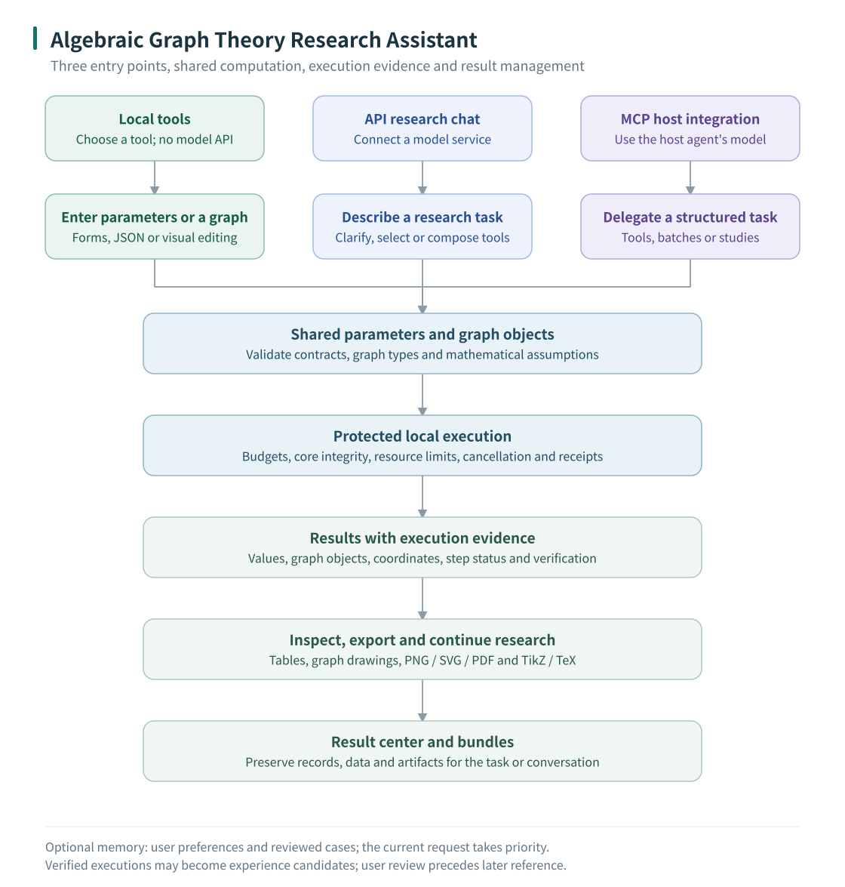

# Algebraic Graph Theory Research Assistant — User Guide

Prerelease **0.38.0a2**, [MIT licensed](../LICENSE). [中文使用指南](../使用指南.md) · [Project home](../README.md)

This Python application provides graph and hypergraph computation, symbolic algebra, interactive drawing and research result management. Use the desktop manually, connect a model for research chat, or expose the same computation tools to a host agent through MCP. SageMath and WSL are not required.

The experiment workflow supports reviewed finite studies, replaceable traditional searches, optional CPU CEM, bounded scheduling, feedback and hypothesis checks. Rules need no model API; model scheduling is optional. Protected execution, independent metric verification and persistent budgets remain in force. See [Research experiments](EXPERIMENTS.md#english) for examples and limits; the dedicated desktop study UI is a later stage.

The desktop supports **Simplified Chinese and English**. Open **语言 / Language** at the top and select **English** or **简体中文**. This guide retains Chinese labels alongside English meanings so it also works when the interface is in Chinese.

The menu switches open UI labels and built-in tool help immediately and saves the selection for the next launch. Form/JSON drafts, model settings and running calculations are preserved. Switching sends no model request and does not recompute anything.

Preferences are saved in `~/.graph_research/desktop-language.json`. For a one-launch override, run `python -m graph_research desktop --language en` or `--language zh`; this does not automatically overwrite the saved selection.

User input, graph names/vertex labels, raw JSON, code, model replies and historical record contents remain in their original language. UI language does not alter user-memory preferences for model answers, mathematical parameters or budgets. Custom third-party extension text retains recognizable original names. Standard buttons in native OS file dialogs can follow the operating-system language. Restart after upgrading to load the new menu.

## 1. Capabilities and usage modes

| Area | Supported capabilities |
| --- | --- |
| Graphs | Construction and transformations, invariants, isomorphism and symmetry, quotient matrices, numerical spectra, exact characteristic/matching polynomials, energy, weighted and directed matrices |
| Hypergraphs | Construction and transformations, structural analysis, uniform-hypergraph α-spectral radius and Perron vectors, weighted incidence matrices, tensor equations and bounded exact characteristic-polynomial elimination |
| Algebra and combinatorics | Matrix and block operations, recurrences, integer linear systems, symbolic sums/series, finite permutation groups, Cayley graphs and rook polynomials |
| Visualization | Mouse construction, draggable layouts, saved coordinates, PNG/SVG/PDF and TikZ export, paper schematics with hyperpaths of unspecified length |
| Research workflows | Batch computations, session result bundles, result cleanup/recovery, user preferences, reviewed research experience and separate extension packages |

There are **47 built-in computation tools**. The desktop groups some drawing/layout/export operations beside the relevant graph. All three modes share tool definitions and the protected computation core.

Development source adds [counterexample search and independent verification](COUNTEREXAMPLE_SEARCH.md) for connected unweighted undirected simple graphs with fixed vertex/edge counts, up to **128 vertices and 1024 edges**. Rules-based search needs no model API. Verification uses exact characteristic polynomials up to 12 vertices and independently checked rational spectral bounds for larger graphs; unresolved comparisons remain unverified.

| Mode | Start here | Assistant model API required? |
| --- | --- | --- |
| Local tools | **本地工具** — select a function and fill its form | No |
| API research chat | **科研对话** → **模型设置** — configure a compatible service | Yes; a compatible local model service is also possible |
| MCP delegation | Let a compatible host start the local STDIO server | No for fixed tool tasks; the host uses its own model configuration |



Non-uniform hypergraphs can be drawn. Hypergraph tensor-spectrum tools enforce uniformity and their other mathematical conditions. Exact elimination, enumeration and numerical calculations have tool-specific limits; an unresolved or unconverged result is not a proof or a counterexample.

The 0.38.0a2 source and wheel include [model research planning](RESEARCH_PLANNING.md) and [general experiments](EXPERIMENTS.md). The desktop Research experiment switch uses the model planning workflow. The separate prepare/execute/study workflow is available through CLI, Python and MCP; its dedicated desktop form is not yet implemented.

## 2. Download and install

### Choose a package

For a new installation, download the **v0.38.0a2 corrected source ZIP**. It includes the file-publication, startup-diagnostic, input-validation and fresh-computer guidance fixes. This is the only retained GitHub Release; main remains the evolving development branch. Older Release assets have been removed, while source history and provenance are retained.

Both packages include the new counterexample-search tools. Source is also available as a [main branch ZIP](https://github.com/735336168liuxiaoqi-hub/algebraic-graph-theory-research-assistant/archive/refs/heads/main.zip).

Use the [v0.38.0a2 prerelease page](https://github.com/735336168liuxiaoqi-hub/algebraic-graph-theory-research-assistant/releases/tag/v0.38.0a2). While the repository is private, sign in with an authorized GitHub account.

| Asset | Intended use |
| --- | --- |
| [Current main source ZIP](https://github.com/735336168liuxiaoqi-hub/algebraic-graph-theory-research-assistant/archive/refs/heads/main.zip) | Evolving development source; the fixed Release below already contains the current corrections |
| [0.38.0a2 source ZIP](https://github.com/735336168liuxiaoqi-hub/algebraic-graph-theory-research-assistant/releases/download/v0.38.0a2/algebraic-graph-theory-research-assistant-0.38.0a2-source.zip) | Recommended corrected release with source, guides and launchers |
| [0.38.0a2 Python wheel](https://github.com/735336168liuxiaoqi-hub/algebraic-graph-theory-research-assistant/releases/download/v0.38.0a2/graph_research_assistant-0.38.0a2-py3-none-any.whl) | Install with pip into an existing Python/Conda environment |
| INSTALL_CN.md / INSTALL_EN.md / LOCAL_TEST_PLAN_zh.md | Standalone installation guides and the local agent test plan |
| `SHA256SUMS.txt` / `RELEASE_VALIDATION.json` | Checksums and validation evidence; these are not installers |

Expand **Assets** at the bottom of the release page. Download one application package; you do not need both ZIP and wheel. The first installation downloads dependencies. A fully offline new computer needs separately prepared dependency wheels matching its Windows/Python version.

### Recommended source installation

The complete desktop and protected workflow are validated on Windows. Use **64-bit Python 3.11+**; Python 3.13 is recommended for this release.

1. Sign in to GitHub with an authorized account. On the project page select `main` → **Code** → **Download ZIP**, then extract the whole ZIP. Git is not required. A 404 may indicate missing repository access.
2. Use a short, writable path such as `C:\Research\agt-assistant`. The actual project directory must contain `pyproject.toml`, `graph_research`, `tools` and `start-desktop.cmd`; do not run inside the archive or move only the executable.
3. On the [official Python Windows page](https://www.python.org/downloads/windows/), select **Python 3.13.x → Windows installer (64-bit)** for a regular Intel/AMD x64 Windows PC. Use the normal installer rather than an embeddable, source, 32-bit, ARM64 or experimental free-threaded distribution. The local verification baseline was 3.13.9; the website's latest-version button may select another series.
4. Run the installer, enable **Add python.exe to PATH** and install for the current user. Close old terminals, open PowerShell from Start and check `py -3.13 --version`. If only `python --version` works and reports 3.13.x, use `python` instead of `py -3.13` below. If neither works, resolve installation/PATH first; see the [official Windows guide](https://docs.python.org/3/using/windows.html).
5. Run the commands below, replacing the directory with your extracted location. Wait for installation to complete and resolve errors before launching. Ordinary use does not require VS Code, Conda or development-test tools.

```powershell
Set-Location -LiteralPath 'C:\Research\agt-assistant'
py -3.13 -m venv .venv
.\.venv\Scripts\python.exe -m pip install -e ".[all]"
.\.venv\Scripts\python.exe -m graph_research doctor
.\.venv\Scripts\python.exe -m pip check
.\.venv\Scripts\python.exe -m graph_research protect check
.\.venv\Scripts\python.exe -m graph_research desktop
```

No activation or PowerShell execution-policy change is needed. `[all]` installs desktop, plotting, API-chat and MCP dependencies, **excluding optional PyTorch**. Enumeration, random and local search do not need torch. For CEM, follow the CPU instructions below in this same environment. The checks should report the intended environment, no dependency conflicts and integrity `ok: true`; they do not request a model.

`.venv` holds this project's Python and dependencies, not a language model. Use its explicit interpreter path for further installation and diagnostics. A source ZIP does not transfer the old computer's environment or PyTorch installation; recreate them on the new computer. Initial installation needs internet access even for subsequent no-API use.

On later runs, double-click **`start-desktop.cmd`** or **`algebraic graph theory research assistant.exe`** in the same directory. The `.exe` is a launcher using the project's `.venv` and source, not an installer containing Python. Keep the whole directory. Recreate the environment after moving it or transferring it to another computer.

### Existing Conda or virtual environment

Activate the intended environment, enter the extracted source directory, then run:

```powershell
python -m pip install ".[all]"
python -m graph_research doctor
python -m pip check
python -m graph_research protect check
python -m graph_research desktop
```

You can also launch `graph-research-desktop` from that environment. The source-tree `.exe` and `start-desktop.cmd` specifically look for the project's `.venv`; they do not select an activated Conda environment automatically.

For editable development, use `python -m pip install -e ".[all]"`. Ordinary use does not require development dependencies or the complete test suite.

### Wheel installation

Download the wheel through your browser. From its directory, use the Python environment you selected:

```powershell
python -m pip install ".\graph_research_assistant-0.38.0a2-py3-none-any.whl[all]"
python -m graph_research desktop
```

A wheel is not a double-click application. pip does not inherit browser authentication, so use the local downloaded file for a private repository. For base library use, omit `[all]`; optional extras are `visual`, `tools`, `desktop`, `assistant`, `mcp` and `search`. PyTorch is optional and excluded from `[all]`.

### Optional CPU PyTorch for CEM

After source installation, run these commands from the same project directory only if you need CEM learning search:

```powershell
.\.venv\Scripts\python.exe -m pip install "torch==2.14.0+cpu" --index-url https://download.pytorch.org/whl/cpu
.\.venv\Scripts\python.exe -m pip install -e ".[all,search]"
.\.venv\Scripts\python.exe -m pip check
.\.venv\Scripts\python.exe -c "import sys,torch; print(sys.executable); print(torch.__version__); print(torch.__file__); print(torch.tensor([1.,2.])+1); print('CUDA build:',torch.version.cuda)"
```

The locally verified version is 2.14.0+cpu from the [official CPU source](https://pytorch.org/get-started/locally/). Expect this project's `.venv` paths, `2.14.0+cpu`, `tensor([2., 3.])` and `CUDA build: None`. No GPU, CUDA, torchvision or torchaudio is required. A successful import is required; pip success or a package directory alone is insufficient. Restart the assistant/MCP service and keep the PyTorch version when continuing a CEM checkpoint. CEM currently uses CLI/MCP study workflows; it is not a chat model.

### Confirm installation and choose an entry point

Run the first five-vertex path calculation in section 3: expect 5 vertices, 4 edges and diameter 4. This checks real protected computation; opening a window alone does not verify worker startup.

- Manual local tools: use section 3 without model credentials.
- Research chat: configure a model service, model ID and local key using section 4. Installing Python does not provide a model service.
- Host-agent integration: follow section 5. Generate MCP configuration on the new computer so it contains the new interpreter path: `.\.venv\Scripts\python.exe -m graph_research mcp-config --root C:/Research/agt-state --user researcher`. This prints configuration; it does not install/configure the host. Fixed tools and rules studies default to zero internal model calls; CEM additionally needs the dependency above. Verify a P3 diameter task before a longer study.

## 3. Local tools — no model API

### First computation

1. Choose **Local tools / 本地工具**.
2. Under **普通图** (Graphs), select **图的基本信息** (`graph_invariants`).
3. Set graph type to `path` and vertex count to `5`, or use **填入示例** (Fill example).
4. Click **开始计算** (Start computation).
5. Expect 5 vertices, 4 edges, diameter 4 and degrees `[1,2,2,2,1]`.
6. Inspect the overview, tables, graphics/files and raw data. **查看结构图** means View structure.

Required fields must be filled. Optional fields are enabled by checkboxes. Dropdowns have localized names and contextual hover help; **说明与示例** means Help and examples. Full JSON and parameter-file import are also available. Filling/importing parameters prepares a form without starting computation.

See the [input manual — Chinese](OFFLINE_INPUTS.md) and [importable examples](../examples/offline-inputs).

### Enter your own graph

Open **图输入** (Graph input) for edge lists, adjacency/incidence matrices, graph6, JSON, graph families, graph-library objects or mouse construction. Confirm type, direction, weights and isolated vertices, then select **使用此图** (Use this graph). Comparison tools let you choose the left or right graph.

For a four-vertex graph with edges `[[0,1],[1,2]]`, specify `n=4` to retain isolated vertex 3. Numbered calculation inputs retain an explicit mapping to original labels; tools reject inputs they cannot preserve. In mouse editing, the first delete click previews the impact; click the same object again to delete. Empty space or Esc cancels.

### Drawing, layout and TikZ

- Before computation, **绘图与导出** (Drawing and export) can use the graph prepared in the form or graph-input window.
- After computation, use **查看结构图** or **绘图 / 布局 / LaTeX** beside the relevant graph. Select the object first for multi-graph results.
- Drag vertices to update curves immediately. Use the wheel to zoom and **适应窗口** (Fit to window) to restore the view.
- **保存坐标** (Save coordinates) writes graph-and-position JSON for later import.
- Set options under **图片设置** (Image settings), then **生成图片** (Generate image). Save the actual attachment from **图形与文件** (Graphics and files); a preview alone is not a saved image.
- Use **LaTeX设置** → **导出LaTeX** for TikZ. Weighted/directed output retains original weights and arrows within its supported contracts.

Ordinary graphs have automatic layouts and coordinate transformations; hypergraphs support spring/circular layouts and manual dragging. Spectral coordinates can overlap or be non-unique; inspect warnings and adjust the layout rather than treating it as an isomorphism certificate.

Enable **Show vertex coordinates / 显示顶点坐标** below the drawing canvas to see positions update while dragging. Choose **Original coordinates / 原始坐标** or **TeX export coordinates / TeX 导出坐标**, and all or selected vertices. Original positions are logical coordinates, not screen pixels; their displayed numbers are shortened while saved values retain full precision. TeX positions match the export's translation, scaling and decimal formatting. For ordinary structure drawings, the default export is centered and uniformly scaled to a longest span of 10 cm; paper schematics use their existing cm coordinates. These editor overlays are excluded from images, TeX labels and saved JSON. The offline HTML layout editor has the same display choices.

TeX coordinates and label offsets now use at most four decimal places by default, stripping trailing zeros and negative zero. Precision increases automatically if rounding would merge distinct vertices or collapse a whole nonzero path segment, falling back to full precision if necessary. This affects TeX source only; saved coordinates, calculations and PNG/SVG/PDF image exports retain their existing behavior.

To name the whole drawing, use **Figure label / 图标签** below the graph-input, structure-preview, native layout or paper-schematic canvas. Enter `G_1`, `H_k`, `G_{n+1}` or `(a)`, choose **Below graph / 图下方** or **Above graph / 图上方** and a font size, then click **Apply label / 应用标签**. Simple subscript notation and Unicode subscripts/superscripts are displayed as such; input is never executed as TeX. Drag the label in move mode to adjust its position. Clear the text and apply to remove it. Use Fit to window if the label is outside the current view.

The label is saved separately in `style.graph_label` and restored with layout JSON. Graph PNG/SVG/PDF and TikZ exports, and paper-schematic SVG/TeX exports include it. It does not change the file name, vertex identities, edges or numeric calculations, and does not affect the TeX normalization of the graph. Existing drawings without a figure label retain their output.

Generating TeX needs no compiler. Compiling it to PDF requires a separate TeX environment; automatic complete TeX compilation is not included. See [graphics — Chinese](GRAPHICS.md) for detailed options and limits.

### Paper schematics

**论文示意图** (Paper schematic) supports central edges, omitted hyperpath sections, ellipsis points inside edges, parameter labels and braces. Use mouse editing, save scene JSON and export SVG/TeX. Ordinary structure drawing remains available.

Line width and the three color buttons have their own style row. **Line color**, **Vertex color** and **Hyperedge fill** show current swatches; hover to read the color code. They resize to fit both languages, update on scene loading, and leave data unchanged if color selection is cancelled. Hyperedge fill controls central-edge fill, not the canvas background.

Graph summaries distinguish vertices, edges/arcs and hyperedges, including singular/plural counts and **No hyperedges**. Generated **Expanded** markers and **Structure preview / Input graph / Result graph** labels follow the selected language. Custom names, labels and stored graph data remain unchanged.

A path of unspecified length is a symbolic diagram, not a fully defined computation graph. Fix its parameters and expand it into a concrete graph before numerical calculation.

## 4. API research chat

### Configure a model

1. Choose **科研对话** (Research chat) → **模型设置** (Model settings).
2. Select the protocol, enter the service's base URL and actual model ID, and choose a key source if required.
3. Enter the model ID manually or use **获取模型列表** (Fetch models) where supported.
4. Select supported reasoning effort or **服务默认** (Service default).
5. Click **保存并启用** (Save and enable). Named profiles let you switch service/model/effort above the input area.

The client supports Responses and Chat Completions compatible formats. The service must accept the selected protocol and return the assistant's JSON decisions; other authentication/message formats can require adaptation.

Saving/loading/switching does not send a model request. Fetching models contacts the service; **测试连接** (Test connection) sends one diagnostic request that may be billed. Options depend on the service. Service default omits the reasoning parameter.

Provide credentials locally through temporary settings or the chosen environment variable. Keys are not saved in public configuration files. Do not put them in task text, source or shared logs. Closing the application or **断开并清除密钥** (Disconnect and clear keys) clears process-held credentials.

### Ask, inspect and continue

Example request:

> Compute the adjacency spectrum and diameter of the path on five vertices. Draw it, export TikZ, and bundle the results.

Send with the button or Ctrl+Enter; Enter inserts a line break. **插入图** (Insert graph) binds an explicit graph version. **先查看计划** (Review the plan first) allows plan inspection. Answer clarification questions in the same conversation.

Inspect actual tool arguments, status, verification and attachments; model prose is not execution evidence. Manual graphic exports beside a result execute locally without a new model request and remain subject to the tool budget.

Compose existing tools when sufficient. A missing algorithm requires clarification, an assessment and estimated consumption, then real user approval before separately packaged development. It cannot overwrite the base package.

### Budget and stopping

**预算与用量** (Budget and usage) shows cumulative limits and consumption. Monetary estimates require prices you provide. **停止** (Stop) cancels further scheduling and stops computation subprocesses; an already-sent model request can still wait for response or timeout.

Successful steps/history are preserved. Restart does not resend requests automatically; continuation requires user action. Model switching does not reset budgets or approvals.

For terminal use, run `python -m graph_research connect`. Configuration commands are listed by `python -m graph_research model --help`. See [API details — Chinese](API.md) for endpoint rules, environment variables and diagnostics.

## 5. MCP delegation from a host agent

### Configure this computer

Use the application's interpreter and short, writable state/result directories outside the installed package:

```powershell
.\.venv\Scripts\python.exe -m graph_research mcp-config --root D:/Research/agt-state --results-root D:/Research/agt-results --user researcher --max-tool-calls 15
```

The output contains STDIO transport, an absolute interpreter `command` and startup `args`. It does not edit host settings, connect the service or read credentials. Put command/arguments in the host's local MCP settings, with the wrapper required by that host.

The command accepts `--format codex` for TOML or `--format dsh` for a DeepSeek Harness plugin entry. Refresh/reconnect after saving. Usually the host starts the process; do not also start a second manual copy. Regenerate paths on each computer.

The service exposes **13 scheduling/integration tools**. The 47 computation tools are discovered through the catalog rather than individually expanding the host's tool list.

### First task

Ask the host:

> Use graph_research. Read the graph_invariants contract, then compute the diameter of the path on three vertices using existing tools. Do not invoke the research assistant's own model API.

The expected diameter is 2. The calling sequence is:

1. `research_catalog` retrieves the needed contract.
2. `research_submit` submits explicit steps and returns a `task_id`.
3. `research_get` queries the same task until completion or user interaction.
4. `research_inspect_result` / `research_read_artifact` retrieve full fields and registered files.

`queued`/`running` are not completed results. Keep the same task/request while waiting; retrying a request ID requires identical input. Use bindings to pass results between steps. Scan/batch workflows can group suitable repeated work.

### Models, limits and approval

Fixed tool tasks need no separate assistant API: the host interprets the request and delegates computation. The host's own model setup remains its responsibility.

`--max-tool-calls 15` is this service's per-task tool-attempt ceiling. Task constraints can lower it, not increase it. It is not a host-model token/call allowance. Failures can consume budget; reconnect/resume does not reset usage. Change startup limits and reconnect for subsequent work rather than assuming an existing task receives a fresh budget.

Enable `--allow-development` explicitly for host-requested new tools. Real-user approval through the trusted interface remains necessary; a model cannot approve itself. `--allow-agent` separately enables internal model planning and requires the assistant's model configuration; it is unnecessary for fixed tool tasks.

See [MCP](MCP.md), [batch workflows](BATCH.md) and [host protocol](reference/SUBAGENT.md), currently in Chinese, for schemas, user events and recovery. MCP discovery, protection and result handling add overhead; lower time/token use than direct Python is not guaranteed.

### Reviewed studies: evaluate or search

| Operation | Purpose | Model API |
| --- | --- | --- |
| prepare | Propose finite cases and report ambiguities/capability gaps; no calculation | Not needed |
| execute | Evaluate explicitly supplied graph/hypergraph candidates after user review | Not needed |
| study | Generate and search candidates, diagnose, optionally train CEM and test formal hypotheses | Rules need none; internal model scheduling is optional |

General and uniform hypergraphs may contain cycles; hypertrees are optional constraints. Current hypergraph study objectives are distance spectral radius and edge count. Existing tensor tools have separate uniformity and verification requirements.

Start a model-free example from the main source directory:

```powershell
.\.venv\Scripts\python.exe -X utf8 -m graph_research subagent --root D:/Research/study-state --user researcher --input examples/research-experiments/clique-free-study-request.json
```

The first response is waiting_for_user and performs zero search calls. Review the proposed cases, methods, seeds, rounds and cumulative budget. After a real user decides to continue, substitute the returned IDs and revision:

```powershell
.\.venv\Scripts\python.exe -X utf8 -m graph_research subagent-user --root D:/Research/study-state --user researcher --task TASK_ID --interaction INTERACTION_ID --revision REVISION --action continue
```

Copy `host_user_event.event_id` into resume.json:

```json
{"operation":"resume","task_id":"TASK_ID","event_id":"EVENT_ID"}
```

```powershell
.\.venv\Scripts\python.exe -X utf8 -m graph_research subagent --root D:/Research/study-state --user researcher --input resume.json
```

At segment pauses, the trusted user may continue or provide study-feedback within the approved guidance intervals. Only the trusted host issues events; the parent passes the event ID. Repeating submit or adding approved=true cannot authorize execution. For MCP, submit the corresponding `clique-free-study.json` task body; `*-request.json` files are CLI dispatch envelopes.

Other examples cover cyclic hypergraphs, hypertrees and optional CPU CEM. Scheduling/refinement stays inside the reviewed finite grid; expanding the mathematical scope or budget requires a new review. Bundles preserve raw objectives separately from training guidance, verified instances, checkpoints, structural observations, hypothesis witnesses and proof gaps. CEM is not presumed faster or better than traditional searches. See [general experiments](EXPERIMENTS.md) for settings, feedback and limits.

## 6. Results, memory, extensions and migration

### Results

**导出结果包** (Export result bundle) saves the conversation's calculations and registered artifacts up to that point. Export again after further work. Bundles can contain parameters, scientific data, receipts and image/TeX files. Check actual export status/content rather than relying on a filename.

Open **成果 → 成果中心** (Results → Result center) for project organization, snapshots, keep flags, cleanup previews and recovery. The window shows the actual result location; MCP can set `--results-root` explicitly.

Preview cleanup before confirming. Running or user/approval-waiting tasks cannot be cleaned. Recovery does not recompute or reset budgets. Calculation and export status are distinct. Back up important research separately.

### Memory

Use a stable user ID and the same memory location to reuse explicit preferences and successful tool-use counts. Preferences do not infer or override α, weights, tolerances or other scientific parameters. Current instructions take priority.

Research experience is extracted from verifiable execution records and reviewed before reuse. A historical case does not replace a fresh computation or proof; memory does not train the model. MCP memory/experience access is read-only; trusted user actions manage and review records.

### Extensions

Check existing tools/compositions first. A missing algorithm follows assessment, estimated consumption, user approval, protected validation and independent packaging. Experimental tools retain their validation limits when reused. New dependencies, UI or unrestricted Python beyond the restricted extension mechanism require manual development.

See [results/memory](RESULTS_AND_MEMORY.md) and [extension library](EXTENSIONS.md), currently in Chinese, for management commands and limits.

### Another computer

Reinstall Python/dependencies and regenerate model/MCP paths. Do not copy the old `.venv` instead. Transfer required result bundles, graph documents, memory and extension libraries separately; source packages contain neither personal research data nor credentials.

### Upgrade an existing installation

Export important results and stop active tasks, then download or pull the intended source. Reinstall with that environment's interpreter, run doctor, pip check and protect check, and restart the desktop. Updating an older Release wheel does not install features that exist only on main. For MCP, update the actual launched checkout or pinned runtime, reconnect and refresh contracts; changing a development directory alone does not change a sealed runtime copy.

Historical completed results remain readable. Experiment checkpoints bind the mathematical definition and core version; cross-version continuation is not guaranteed. Do not edit hashes to force compatibility. CEM also requires a compatible PyTorch runtime.

## 7. Troubleshooting

| Symptom | What to check |
| --- | --- |
| Missing/wrong Python | Verify the interpreter; use `py -3.13 -m venv .venv` where appropriate |
| Installation failure | Keep the error and resolve it in the intended environment before launching |
| Launcher does not open | Check the project `.venv`; use the terminal launch command and `outputs/desktop/startup.log` |
| Version/source conflict | Run `doctor`, confirm the interpreter/directory and reinstall the intended source |
| Integrity mismatch | Restore verified source while preserving research data; do not reseal unexplained damage |
| Timeout/nonconvergence | Check tool limits, structured errors, algorithm parameters and verification; an unfinished value is not a conclusion |
| API authentication/model/effort error | Check URL, protocol, model ID, key and service-supported parameters; use Service default if appropriate |
| Missing MCP tools/timeout | Check absolute command path, dependencies and STDIO settings, then reconnect; a manual STDIO process waiting for input is normal |
| Missing Chinese glyphs in figures | Install a suitable font on the target computer and restart; fonts are not downloaded automatically |
| Missing torch for study | Traditional methods remain usable; install the optional dependency in the actual interpreter for CEM, then restart/reconnect |
| Study waiting for review/feedback | Use the current interaction/revision and a trusted user event; repeated submit does not authorize execution |
| Protected startup fails / exit 107 | Read `error_details.startup` and the task's bootstrap-stderr.log. Exit 107 alone does not diagnose a broken environment. If standard-library access is denied, retain diagnostics and check host restrictions; do not disable protection or repeatedly recompute |
| Self-loop, duplicate edge or out-of-range vertex | Follow `field_path` using zero-based indices. Vertices must be in 0..n−1; reversed endpoints still describe the same undirected edge. Use a new request_id for corrected input |
| Doctor reports host customization | This reports loaded Python customization without changing it. If actual writes or startup are blocked, keep diagnostics for the host administrator; do not automatically disable its security modules |

After upgrades, restart desktop/reconnect MCP and refresh contracts. Report version/core fingerprint, a small reproducible input and redacted diagnostics to [Issues](https://github.com/735336168liuxiaoqi-hub/algebraic-graph-theory-research-assistant/issues).

## 8. Reference navigation

This English guide covers installation and the user workflows. Detailed parameter/topic manuals below are currently in Chinese. Tool IDs, JSON keys and parameter values remain unchanged.

| Reference | Content |
| --- | --- |
| [Features](FEATURES.md) | Capabilities, mathematical prerequisites and limits |
| [Inputs](OFFLINE_INPUTS.md) / [Tool contracts](model/TOOL_REFERENCE.md) | Formats, examples, outputs and effects |
| [Graphics](GRAPHICS.md) | Graph input, layout, TikZ and paper schematics |
| [API](API.md) / [MCP](MCP.md) / [Batch](BATCH.md) | Service setup, host integration and multi-case tasks |
| [General experiments](EXPERIMENTS.md) | Reviewed prepare/execute/study, search backends, CPU CEM, feedback and hypothesis checks |
| [Results and memory](RESULTS_AND_MEMORY.md) / [Extensions](EXTENSIONS.md) | Saved research, cleanup, preferences and governed development |
| [Numerical methods](NUMERICS.md) | High-α algorithms, diagnostics and exact tensor elimination |
| [Python interfaces](reference/PYTHON_API.md) | Library use outside desktop forms |
| [Development](DEVELOPMENT.md) / [Contributing](../CONTRIBUTING.md) | Environment, protection, checks and source export |
| [Current release](releases/CURRENT.md) | Delivered scope and recorded validation |
| [Provenance](provenance/README.md) / [Attribution](../NOTICE.md) | Migration records and author credits |

A complete Windows installer, full implicit 3D plotting and automatic TeX compilation are not included. Numerical outputs and finite extension test cases do not establish general theorems. Source-migration records are maintenance references, not a list of missing research capabilities.


## Counterexample search

See [bounded counterexample search and independent verification](COUNTEREXAMPLE_SEARCH.md#english-summary). It supports fixed-n/m connected simple graphs with 2..128 vertices and at most 1024 edges, rule-based search without API, and optional explicitly configured model strategy selection. The download links above refer to the last published rc6 release, which does not include this development feature.
