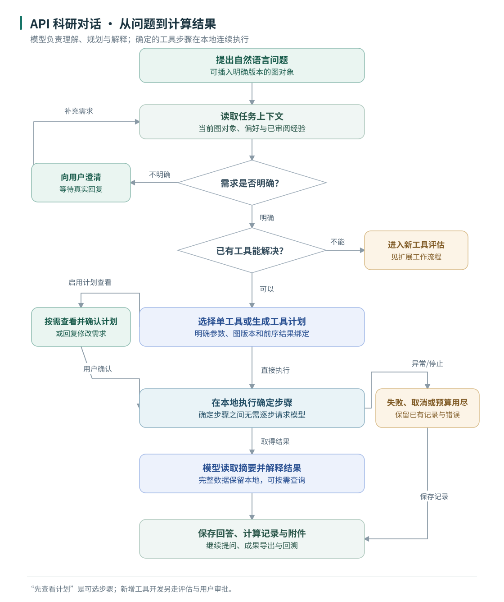
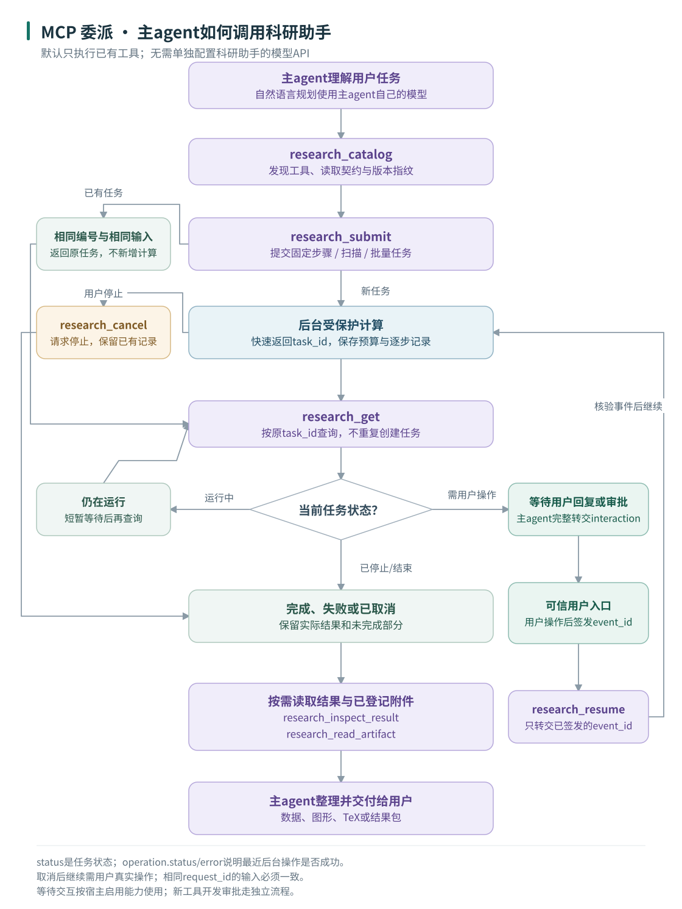
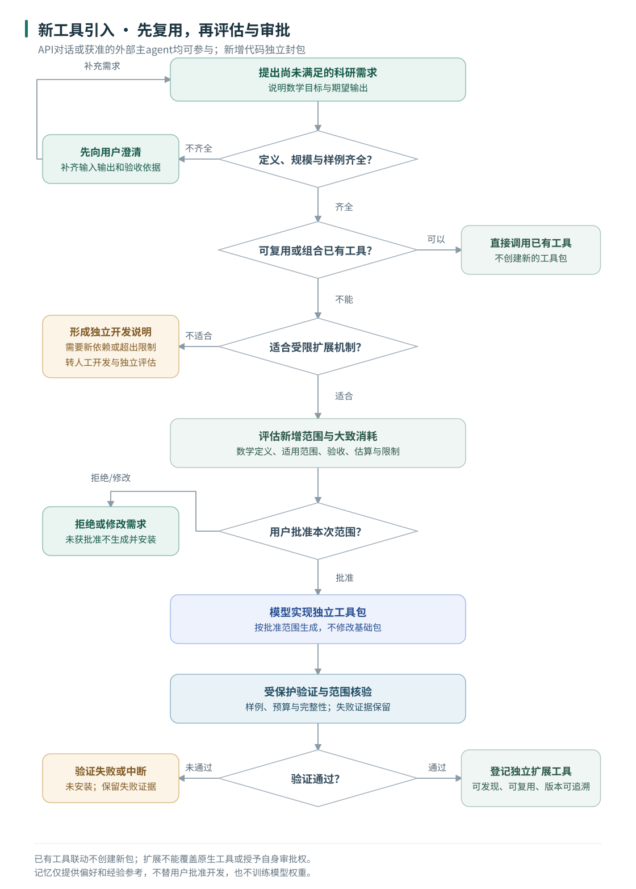

# 工作流程

适用当前0.36.0rc4候选版，整理日期：2026-10-20。这里展示已实现的用户使用路径；A/B验收后提出的性能优化仍是后续工作。数学前提、输入规模及返回字段以各工具契约为准。

初次使用先看总览，再选择对应模式。安装和操作步骤见[使用指南](../使用指南.md)；可编辑的[Mermaid版本](diagrams/MERMAID.md)可在GitHub直接查看，英文总览见[English overview](diagrams/workflow-overview-en.svg)。

## 1. 三种模式总览

| 入口 | 谁决定调用步骤 | 模型配置 | 常见使用场景 |
| --- | --- | --- | --- |
| 本地工具 | 用户按分类选择函数并填写参数 | 无需模型API | 已知要算什么，直接计算、绘图和导出 |
| API科研对话 | 本助手接入的模型理解需求、选择或组合工具 | 在助手中配置兼容服务 | 自然语言研究、澄清条件、连续计算与结果解释 |
| MCP主agent接入 | 主agent负责理解与规划，助手执行结构化任务 | 默认使用主agent自己的模型配置 | 将计算、绘图、扫描和结果文件接入更大的工作流 |

三种模式共用Python计算核心、图对象和执行证据。本地工具与API对话可在桌面中切换；MCP由宿主启动，可以独立使用。直接Python库调用属于开发者入口，图中重点展示三种面向用户的应用路径。

**本地工具的最短路径：**打开桌面 → 选择“本地工具” → 选择函数 → 填入或导入参数 → 开始计算 → 查看数据/图形 → 保存所需结果。选择图对象时保留图类型、方向、权重、孤立点和顶点标签，工具不适用时明确拒绝有损输入。

普通图和一般超图均可画结构；张量谱及张量特征多项式按一致超图及对应工具的其他条件执行。论文符号示意图中的省略路不等于已确定顶点/边数量的数值计算图，需明确参数后展开。

[总览PNG](diagrams/workflow-overview.png) · [Mermaid源码](diagrams/workflow-overview.mmd) · [本地工具与图输入](../GRAPH_INPUT.md)

## 2. API科研对话

**从哪里开始：**桌面切换“科研对话” → 设置模型连接 → 输入问题，必要时插入图对象 → 发送。图对象在会话中有明确版本，模型调用时引用实际对象，构图/变换结果可产生新版本供下一步使用。

条件不完整时先询问用户；已有工具可以直接调用，也可以组成确定的多步计划。“先查看计划”是可选操作：用户可确认执行或回复修改目标，修改后重新规划。确定的工具步骤通过绑定读取前序结果，在本地连续执行，不需要每一步都重新请求模型。单工具、多步计划和只做文字分析都属于现有路径，图示以包含计算的常见任务为主。

计算成功后，模型可读取摘要、按需查询完整字段并解释结果。界面中的工具调用记录与附件用于核对实际执行，模型文字本身不代替计算证据。图形面板中的手动绘图/导出按钮可直接本地执行已有工具，计入原会话与工具预算，不再请求模型。

预算用尽、取消或失败时保留已有记录，导出状态另行显示；需要继续时按实际状态和用户操作恢复，不静默重试或重置预算。新增工具另走第4节的评估与审批。

[API流程PNG](diagrams/workflow-api.png) · [Mermaid源码](diagrams/workflow-api.mmd) · [模型设置](../MODEL_SELECTION.md) · [API任务与对象绑定](../API_WORKFLOWS.md)

## 3. MCP委派

**最短调用链：**主agent读取工具契约 → 提交固定步骤、批量任务或参数扫描 → 保存task_id → 查询状态 → 按需读取结果和附件 → 主agent向用户交付。

| 操作 | 作用 | 使用要点 |
| --- | --- | --- |
| research_catalog | 发现工具、按需取完整契约、识别服务版本 | schema_hash不变可复用；核对service中的版本和核心指纹 |
| research_submit | 注册任务并交给后台执行 | 同一逻辑任务保存原request_id；相同ID必须对应相同输入 |
| research_get | 查询已有任务 | 按原task_id等待，查询不触发重新计算 |
| research_inspect_result | 按call_id及JSON路径读取完整字段 | 大数组按需分页，不把摘要省略当作结果丢失 |
| research_read_artifact | 读取已登记附件 | 按编号分块，完整字节读完后才能核对整个文件SHA |
| research_cancel | 请求停止任务并保留结果 | 查询到后台停止；重复取消复用已有记录与成果包 |
| research_resume | 转交可信宿主签发的用户事件 | 只传event_id，主agent不能替用户批准或伪造回复 |
| research_recover | 后台确已停止后恢复持久化状态 | 只恢复记录，不自动重算；继续仍按真实用户操作处理 |

图示的等待交互分支按宿主启用的任务能力使用。默认纯工具任务按固定步骤执行；取消/中断后由用户决定是否继续。可选的助手内部agent模式需要宿主另外启用并配置模型，不能把它当作MCP工具模式的必要条件。

`status`说明任务处于运行、暂停、完成或失败等哪种状态；`operation.status/error`说明最近一次后台启动/恢复操作是否成功。一次恢复失败可能使任务继续保持`cancelled`且原`error=null`，应检查operation和SDK的isError。`cancelled`可恢复，可能`terminal=false`；是否已停下要结合`transport.active`。

`budget.used`是整任务累计尝试量，`request_effect`说明本次请求是否启动新作业，`operation.usage`为相应作业增量；三者不能重复相加。普通tools任务默认执行到预算用尽，设置`fail_fast=true`可在固定步骤预算不足时预先拒绝；scan/batch按展开预算预检。

**新工具开发使用独立的research_development流程，开发批准不通过research_resume。** 主agent先提交评估，用户在可信入口批准范围，再由模型提交实现；详见下一节与[通用MCP接入](../MCP_INTEGRATION.md)。

[MCP流程PNG](diagrams/workflow-mcp.png) · [Mermaid源码](diagrams/workflow-mcp.mmd) · [接入与结果字段说明](../MCP_INTEGRATION.md) · [批量工作流](../BATCH_WORKFLOWS.md)

## 4. 新工具引入

遇到能力缺口，先明确数学定义、输入输出、规模和可独立核对的样例，再检查工具库能否直接复用或组合。已有工具联动可以解决时直接编排，不创建新工具包。

受限机制可以实现的新算法先给出范围、验收条件和大致消耗，由用户确认本次范围后才生成代码。API模式可由本助手模型实现；获准的MCP开发通道可由主agent实现，无需额外配置助手API。代码独立封包，受保护验证通过后才登记到扩展工具库，不能覆盖原生基础工具。

需要新依赖或超出受限算法机制时，生成独立开发说明并转人工开发/评估，不假称已经自动安装。失败和中断保留证据，尝试次数仍受批准范围限制；实际流程中的修订/重试必须遵守剩余预算，图中未展开全部重试分支。样例通过说明所列样例通过，不等于一般数学正确性证明。

默认离线工具只调用已登记工具，不会自行生成新代码。MCP开发能力需要宿主显式启用；工具列表可发现不代表用户已批准开发。

[扩展流程PNG](diagrams/workflow-extension.png) · [Mermaid源码](diagrams/workflow-extension.mmd) · [新功能开发机制](../FEATURE_DEVELOPMENT.md) · [持久工具库](../TOOL_LIBRARY.md)

## 5. 记忆、证据与成果在流程中的位置

| 数据 | 读取或产生时机 | 边界 |
| --- | --- | --- |
| 用户偏好与使用统计 | 按当前用户和记忆设置读取、更新 | 当前请求优先，偏好不能自动改写科学参数 |
| 已审阅经验 | 作为后续任务的历史参考 | 核对来源、版本和适用条件，不能代替本次计算或证明 |
| 经验候选 | 从可核验的执行记录提取 | 用户审阅前不作为已批准经验返回；不更新模型权重 |
| 计算回执 | 受保护计算成功或失败时保存 | 记录实际输入、结果、用量和错误，不把文字回答当作执行 |
| 图对象与坐标 | 图输入、构图/变换、拖动布局及保存时产生 | 保留结构身份；布局支撑图不替代原有向/带权图 |
| 图片、TeX及结果包 | 按工具与会话的导出操作/设置生成 | 核对实际导出状态、清单和范围；TeX源码生成不代表已编译PDF |

总览图按“计算→查看→整理成果”的用户路径排列；实际记录可在计算过程中就已保存，自动导出也可早于用户打开结果页。导出失败与数学计算失败分别报告，不能因ZIP未生成而丢弃已保存数值，也不能把文件名存在当作文件内容已核验。

详细操作见[成果中心](../RESULTS_CENTER.md)、[结果包](../RESULT_BUNDLES.md)、[用户记忆](../USER_MEMORY.md)和[经验记忆](../EXPERIENCE_MEMORY.md)。

## 6. 图示与文档维护

本页的SVG用于GitHub和缩放阅读，PNG用于下载与展示，Mermaid用于原生渲染和编辑。三者由同一份[流程数据](diagrams/workflows.json)生成，英文总览与中文总览使用相同节点与连线。

维护时按实际实现更新流程数据，再按[图示维护说明](diagrams/README.md)重建并检查。发布状态和许可仍以项目的[许可记录](../LICENSE-STATUS.md)为准。
