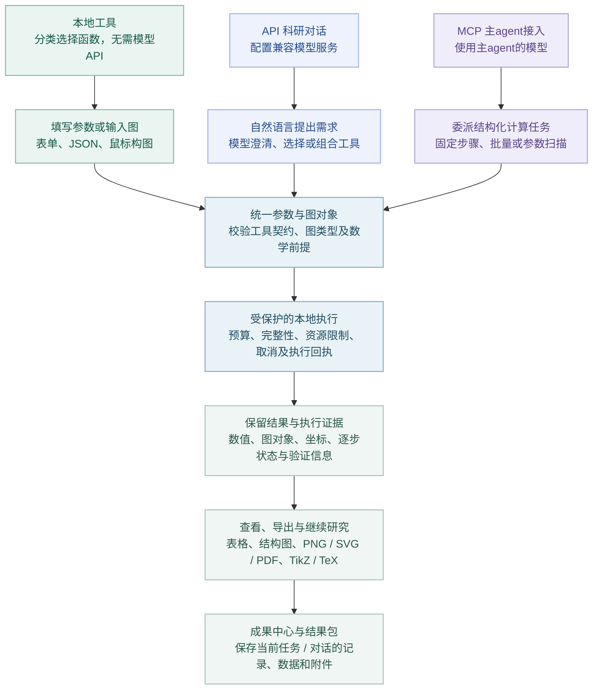
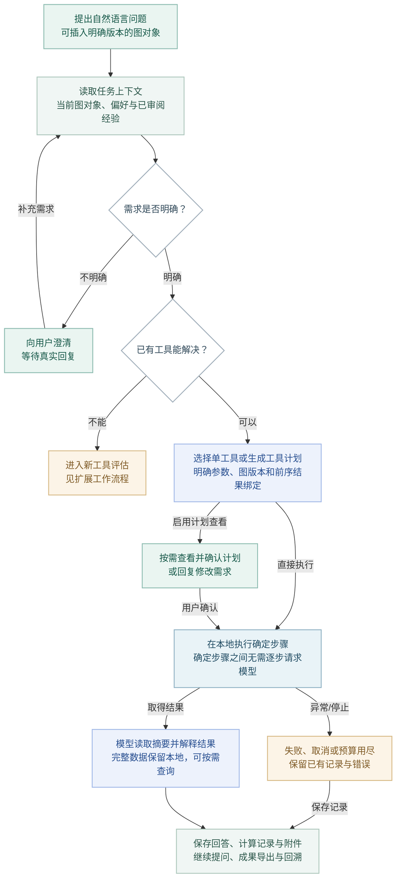
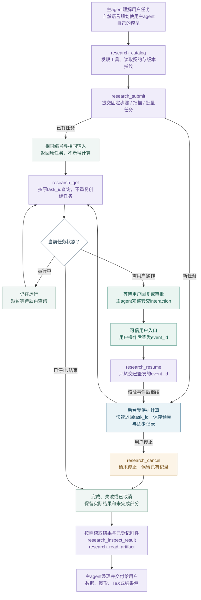
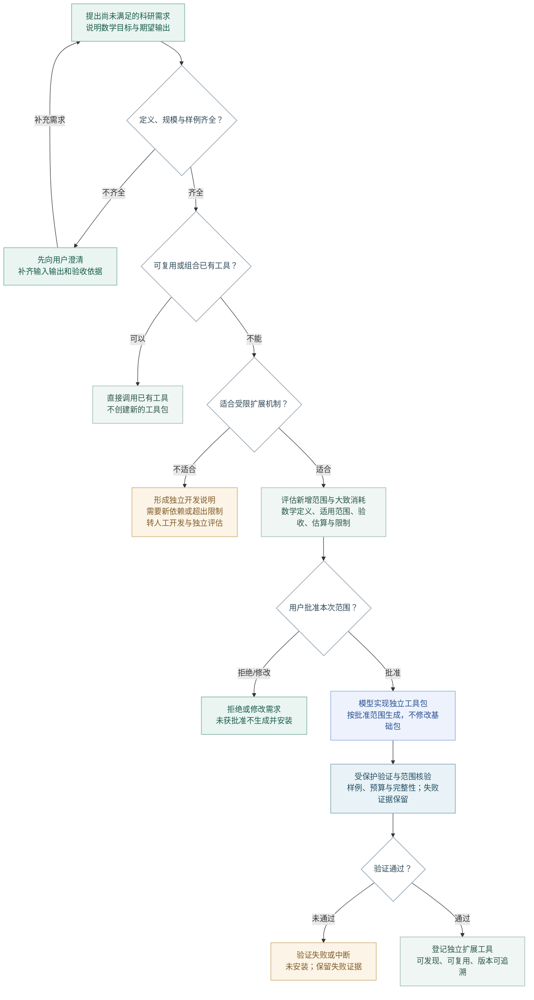
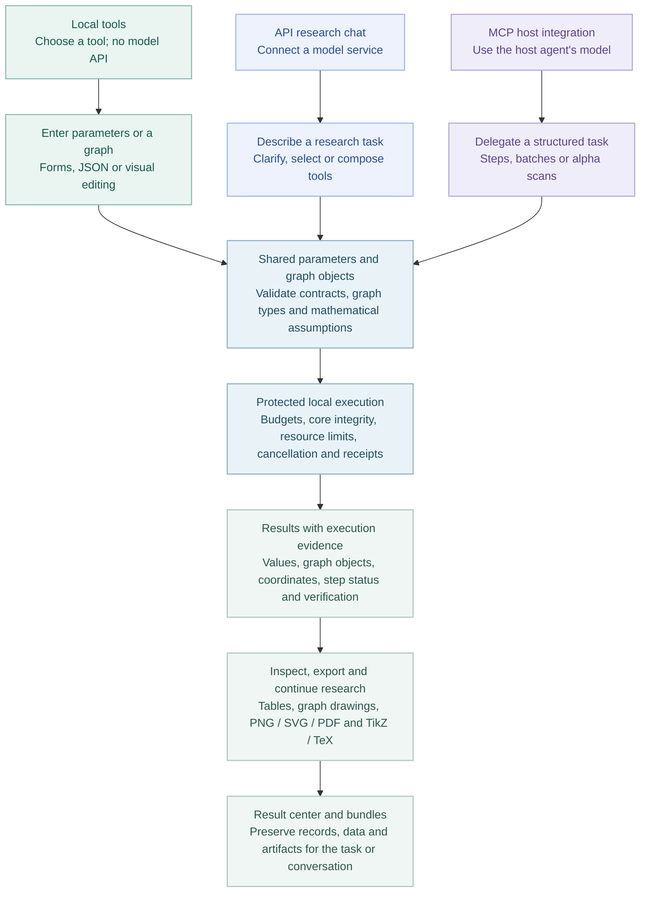

# 工作流程 · Mermaid 版本

由workflows.json生成；图像版本与使用说明见[工作流程](../WORKFLOW.md)。

## 代数图论科研助手 · 工作流程

## API 科研对话 · 从问题到计算结果

## MCP 委派 · 主agent如何调用科研助手

## 新工具引入 · 先复用，再评估与审批

## Algebraic Graph Theory Research Assistant

