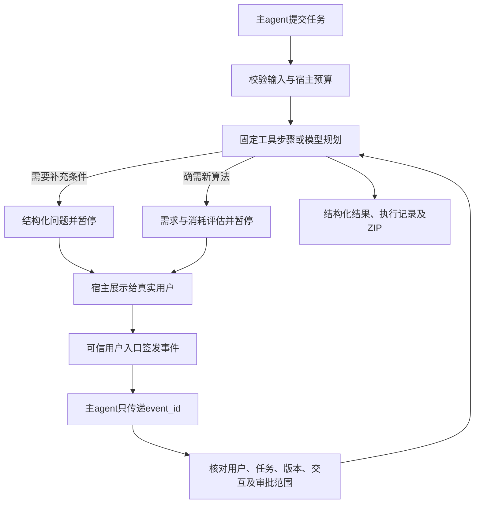

# 子agent宿主集成协议

**本接口是可选的。** 不接主agent时，直接运行`python -m graph_research standalone --user researcher_001`，或双击`start-assistant.cmd`选择4，助手可自行理解任务、调用工具、询问用户、评估并等待开发审批、生成独立工具包和汇总结果。独立模式使用原`ResearchSession`，不需要父任务、宿主事件ID或本机事件签名密钥；自然语言对话仍需[配置模型](../API.md)。

本版增加统一的任务输入、结构化返回、暂停等待用户与审批传递接口。主agent可把图论计算委派给此助手；宿主负责展示问题、确认用户身份和接收真实用户操作。没有绑定特定模型或主agent框架，没有部署网络服务。

## 接入边界



Python工厂返回两个对象：`parent`供主agent调用，`portal`仅供可信宿主的用户操作处理器调用。把`parent.dispatch`注册为主agent工具即可；**不得把portal、`subagent-user`命令或可调用它们的任意本机命令权限交给模型**。对象本身不是用户身份认证系统，同一账户下拥有任意本机代码执行权限的进程也不在这条隔离边界内。

宿主在已验证的用户会话中设置`user_id`、存储目录和权限上限。它们不能由任务JSON自行指定。目录应由宿主管理，不能放在不可信计算可写或公开共享的位置。默认用户记忆、任务和实验工具包分开存储；沿用同一用户ID和根目录即可跨进程恢复。

Windows未启用长路径时，建议把存储根目录控制在约90字符内（例如`C:/Research/state`）；内部已缩短用户目录名，完整用户摘要仍用于记录和事件校验。

## 统一任务输入

安装完整功能使用`pip install ".[all]"`或对应wheel的`[all]`。固定步骤可使用`[tools]`，不需要模型或LangGraph；模型规划使用`[assistant]`。本版受限计算后端在Windows实现。

```python
from graph_research.assistant import create_subagent, SubagentLimits

parent, portal = create_subagent(
    "./research-state",
    user_id="researcher-001",            # 可信宿主确定
    limits=SubagentLimits(max_model_calls=8, max_tool_calls=6),
    # model_factory=lambda: your_model_adapter,
)

task = {
    "version": 1,
    "request_id": "study-001-spectrum",  # 同一操作重试时保持不变
    "parent_task_id": "study-001",
    "objective": "计算P3邻接谱，并复核邻接矩阵的秩",
    "inputs": {"kind": "path", "n": 3},
    "definitions": ["普通无向简单图，使用邻接矩阵A"],
    "expected_outputs": ["谱半径", "矩阵秩", "可校验的计算结果包"],
    "execution": {
        "mode": "tools",
        "steps": [
            {"id": "spectrum", "tool": "graph_spectrum", "arguments": {},
             "bindings": {"kind": {"input": ["kind"]}, "n": {"input": ["n"]}}},
            {"id": "rank", "tool": "matrix_analysis", "arguments": {},
             "bindings": {"matrix": {"step": "spectrum", "path": ["matrix"]}}},
        ],
    },
    "constraints": {"max_model_calls": 0, "max_tool_calls": 2, "allow_extensions": False},
}
result = parent.submit(task)
assert result["status"] == "completed"
assert result["results"][1]["data"]["rank"] == 2
```

`arguments`为固定JSON参数；`bindings`读取输入或前序结果的对象键、列表索引，不执行表达式，不允许前向引用、环或重复步骤ID。工具联动不会新增工具包。

需要模型分析时，使用`"execution": {"mode": "agent"}`并移除`steps`。输入中的问题、数学约定、原始数据和预期输出会写入模型上下文及结果包。模型适配器只需提供`complete(messages)`并返回既有科研决策JSON；不指定工厂时使用[本机API配置](../API.md)，机器接口不会等待终端输入密钥。

输入最多256KiB。`request_id`在同一用户下用于幂等：相同规范化输入返回现有状态，不重新计算；同ID配不同输入、约定或预算会报`request_id_conflict`。`parent_task_id`只用于追踪，不提供权限。

## 结构化返回

每个合法任务返回协议`graph-research-subagent/1`和以下固定顶层字段：

| 字段 | 含义 |
| --- | --- |
| `task_id / request_id / parent_task_id / revision` | 任务、原请求、父任务与当前修订号 |
| `status / terminal / next_actions` | 当前状态、是否结束、接下来可做的操作 |
| `answer / summary` | 可读说明、成功/失败/已核验调用数及执行是否完成 |
| `results` | 每次工具的参数、成功/失败、计算数据和执行记录；标明原生或实验性工具 |
| `interaction` | 等待用户时的问题、交互ID、允许操作；审批时含完整评估和范围摘要 |
| `budget` | 固定权限与限额、累计尝试数、剩余次数 |
| `artifacts` | 结果ZIP、实验扩展ZIP的本机绝对路径及SHA256 |
| `error / warnings / updated_at` | 机器可读错误、局限与更新时间 |

| 状态 | 宿主处理 |
| --- | --- |
| `queued / running` | 已登记或正在执行；查询状态，不重复创建任务 |
| `waiting_for_user` | 展示`interaction.questions`，等待真实用户补充 |
| `waiting_for_approval` | 展示`interaction.assessment`中的开发范围、验收与消耗，等待批准、拒绝或修改需求 |
| `completed` | 此次执行完成，读取实际结果与记录；不代表数学命题已证明 |
| `partial` | 保留了部分计算；有失败或结果包未完成，检查明细 |
| `analysis_only` | 仅返回分析，没有新计算结果 |
| `failed / blocked / budget_exhausted / rejected` | 本次已结束；分别为失败、策略阻止、预算耗尽或用户拒绝 |
| `cancelled / interrupted` | 已暂停；保留已有结果，需用户明确选择继续 |

无效消息返回独立的`status: protocol_error`及`error.code/message`，不会伪装成合法任务结果。Python的直接方法抛出`TaskProtocolError`；JSON适配层`dispatch`将协议错误转成JSON。

`summary.mathematical_proof`始终为`false`。`verification.level: host_recorded_execution`表示记录了实际执行，`verified_calls`表示结果包核对了回执和文件，不是一般正确性证明。扩展的`fixture_tested_experimental`结果仍需科研复核。

内联计算数据合计超过1MiB时返回`data_ref`。跨机器接入应由宿主提供文件下载映射，不要把本机路径当成公网URL。对ZIP可调用`verify_bundle(path, sha256)`核验；`get`检查返回快照，但不会每次重新读取、重算和核验所有附件。接收实验扩展ZIP不会自动安装。

## 暂停与真实用户回复

假设`result`已处于`waiting_for_user`，宿主展示全部问题并收到用户输入后：

```python
pending = result["interaction"]
# 此段仅在可信宿主收到真实用户输入之后执行。
event = portal.answer(
    result["task_id"], pending["interaction_id"], result["revision"],
    text=user_entered_text,
)
# event_id可传给主agent；它只引用宿主已签发的用户操作。
result = parent.resume(result["task_id"], event["event_id"])
```

调用`portal.answer`只记录事件，不调用模型或计算。等待时进程可以退出；使用相同根目录及用户ID重新创建接口，调用`get`、再`resume`即可。没有轮询模型、后台占用或等待用户时的额外模型消耗。

事件绑定用户、任务输入摘要、任务ID、修订号和交互ID，并用本机宿主密钥HMAC签名。默认未消费事件1小时过期，可由宿主通过`event_ttl`调整。密钥不在返回JSON或科研结果ZIP中。不要把用户ID或`actor: user`等模型生成的字段当作认证。

宿主可为同一次点击预先生成32位十六进制`event_id`传给portal，重试签发时须保持操作内容一致。已消费事件再次`resume`返回原事件对应的缓存结果，不重复执行；即使任务后来继续发展，也返回当时快照，需要最新状态请`get`。未消费的旧交互、其他任务事件、篡改或过期事件不能用于恢复。

## 审批传递

`waiting_for_approval`时，主agent将`interaction`交给宿主展示。用户确认当前评估后，可信宿主签发：

```python
p = result["interaction"]
event = portal.approve(
    result["task_id"], p["interaction_id"], result["revision"],
    p["assessment_id"], p["scope_sha256"],
)
result = parent.resume(result["task_id"], event["event_id"])
```

拒绝时同样使用这些绑定参数调用`portal.reject(..., reason="暂不开发")`；拒绝不需要再次调用模型。修改需求使用`portal.answer(...)`，产生`revise`事件，原评估和旧批准失效，必须重新评估、重新确认。

父接口没有`approve`操作，`approved: true`、伪造用户角色和聊天里的“同意”无法越过入口。审批不提高预算，不批准其他任务，也不会修改基础包。已批准的新工具仅追加到本任务可调用范围，仍经过原有受限开发、验收及独立封包流程。

## 预算、取消与故障恢复

`SubagentLimits`是可信宿主上限；任务`constraints`只能降低它。默认总上限为模型10次、工具10次；可指定工具白名单、禁止开发扩展，以及每次工具计算的用时、CPU、内存和进程数。模型和工具调用前持久化预扣尝试数，失败、中断、用户回复和重启都不重置次数。开发验收另受原开发评估预算及单次隔离限额控制，不计为普通工具调用次数。

调用次数不是token账单或实际费用；每次工具用时不是整任务总期限。提供商费用需要配置单价后估算。跨任务/全项目总预算、并发调度、网络认证及费用对账由宿主负责。宿主收紧策略后，不允许旧任务沿用超出的权限继续。

`parent.get(task_id)`只读状态；`parent.cancel(task_id)`保存取消请求，计算进程响应后停下。远程模型请求可能需等待返回或网络超时。取消可从另一个宿主线程或进程发起。

接口是同步调用，不附带后台任务队列；宿主可放入自己的工作线程。进程崩溃后先`get`，再调用`recover(task_id)`将孤立的`queued/running`转换为`interrupted`，不会自动重算；活动任务仍持有锁时拒绝恢复。用户明确选择继续后，调用`portal.continue_task(task_id, interaction_id, revision)`签发事件，再`resume`。

固定步骤已有持久化成功结果和有效回执时跳过重算。硬崩溃时尚未完整落盘的一步可能需要重做；接口不声称所有故障下精确执行一次。遇到审批提交过程中的不确定故障可重新委派并重新评估，不扩大旧批准。

## 框架中立的JSON传输

```python
from graph_research.assistant import subagent_tool_definition, subagent_contracts

definition = subagent_tool_definition()  # 按主框架要求包装为函数工具
response = parent.dispatch({"operation": "submit", "task": task})
response = parent.dispatch({"operation": "get", "task_id": response["task_id"]})
schemas = subagent_contracts()           # 输入、结果、父操作的JSON Schema
```

父操作只有`submit / get / resume / cancel / recover`。不同模型供应商的函数工具格式可能需要包装；没有宣称已与某个真实主agent完成联调。

可直接读取[机器可读协议](../model/subagent-contracts.json)，包含任务输入、任务返回、父接口操作和函数工具定义。它与`subagent_contracts()`使用相同来源。

```powershell
python -m graph_research subagent-schema
python -m graph_research subagent --root .\research-state --user researcher-001 --input request.json
# request.json正文：{"operation":"submit","task":{...}}
# 也可从stdin读取JSON。stdout为JSON，不会交互询问模型密钥。
```

可信本机用户操作可使用单独的`subagent-user`命令，参数含`--root --user --task --interaction --revision --action`，批准/拒绝另需`--assessment --scope`，回复用`--text`。它只签发事件，仍需父接口传递`resume`。这是可信宿主入口，不是对外用户登录接口，不能向模型开放。

离线示例：

```powershell
python examples/subagent_demo.py --output outputs/subagent-v015
# 默认停在开发审批，不自动批准。仅离线测试可显式模拟用户确认：
python examples/subagent_demo.py --simulate-user-approval --output outputs/subagent-v015-approved
```

示例使用脚本模型，真实API调用为零；报告明确标记模拟同意。可检查`report.json`、协议Schema、逐阶段返回JSON和实际计算ZIP。

## 通用MCP连接（v0.28）

本地STDIO入口复用本任务协议，提供异步提交、查询、取消、恢复、可信event_id续做、按需工具说明和登记附件读取。默认仅已有工具，内部模型与实验扩展分别由宿主启动选项显式启用。MCP不会签发用户事件，也没有批准工具。使用方法和Codex/DSH配置生成见[MCP接入说明](../MCP.md)，机器可读工具Schema见[定义](../model/mcp-tools.json)。

## 成果中心与清理终态

设置`create_subagent(..., results_directory=...)`后，返回包附稳定成果/版本编号及友好名称；成果改名不改变SHA256，查询和附件读取继续解析已登记路径。整任务清理返回`cleared`终态，保留request_id、任务编号和已用预算，不重复执行；通过成果中心回收区恢复后可再次取得原记录。未设置results_directory的直接Python调用继续使用原导出方式。

## 固定α扫描

新增execution.mode=scan，输入为scan对象，含edges或generator及alphas；复用已有固定步骤后端，预算按构图和每点分别预扣尝试数。失败点保留且不自动重试，取消后的继续仍由可信用户门户签发事件，已核验完成点不会重算。完整契约由subagent-schema返回，示例见[MCP实测改进说明](../MCP.md)。

## 批量工作流

v0.33支持多案例模板、依赖绑定、预检和统一成果汇总，见[../BATCH.md](../BATCH.md)。

## 只读记忆与科研经验（v0.34）

主agent可使用research_memory与research_experience读取当前宿主用户的偏好及已审阅案例。新子agent任务收尾按执行回执生成候选，summary.experience_collection仅报告积累状态；不把候选当作已审阅建议。记忆失败不改变计算状态或预算。可信本机用户按内容哈希审阅后才能检索；旧任务不会自动补采。具体管理及适用边界见[说明](../RESULTS_AND_MEMORY.md)。

## 持久扩展库（v0.35）

已验收扩展可按原tools/batch等模式复用，allow_extensions仍控制内部模型开发权限，不阻止正常调用已登记工具。MCP新增独立research_development流程，主agent提供代码时不需要助手API；它使用独立development_id及本机用户审批，查询用该接口get，不能把它当数学任务task_id。工具目录仅由宿主指定，显式共享方法、版本及预算见[../EXTENSIONS.md](../EXTENSIONS.md)。
